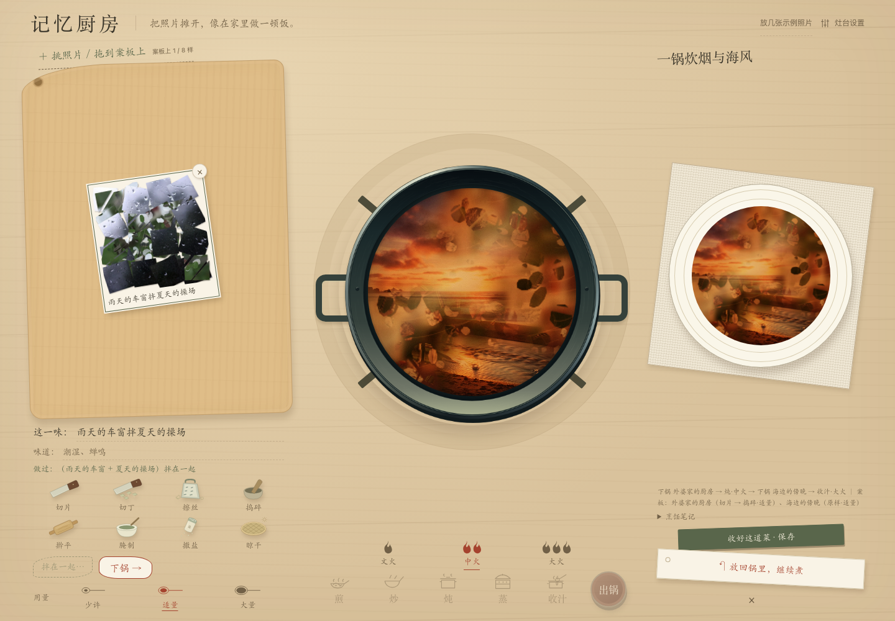
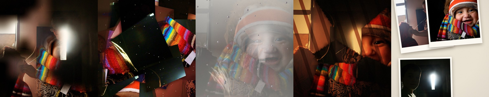
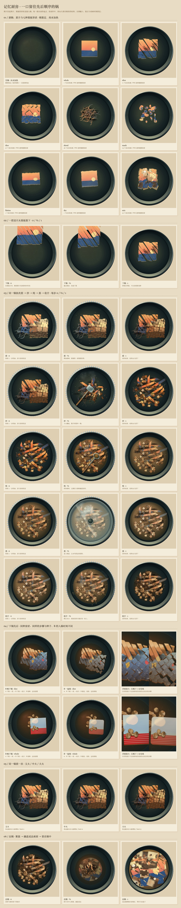

# 记忆厨房 · Memory Kitchen

在线版：https://chenzihong-gavin.github.io/weekly-vibe-coding/memory-kitchen/

照片是食材。像在家里做饭一样分两段：先在**案板**上切一切、捣一捣、腌一腌，处理好了**下锅**——按处理完的形状落进锅里；再在**锅**里按顺序煎、炒、炖、蒸、收汁，最后**出锅**，做成一段从未发生过的记忆——一张新照片。出锅的菜可以再放回锅里，继续煮。



## 怎么玩

整页就是一张灶台（布局来自 Codex 的四版提案中用户选中的「摊开一张灶台」，见 `docs/mockups/`），从左到右就是做饭的顺序：

1. **案板（左）：冷处理。** 拖入、粘贴或点选照片，照片摊在案板上（最多 8 样，只留在本机浏览器）。点一张选中它，可以改名、写一个词当它的「味道」、用量匙选用量，再用 8 把厨具处理它：切片、切丁、擦丝、捣碎、擀平、腌制、撒盐、晾干。每一下都是真的做在照片上、而且回不去：处理读的是照片现在的样子，结果直接烤进照片，所以先切片再捣碎是「捣碎的切片」，先捣碎再切片是「切开的糊」；卡片下面按顺序记着做过什么（如「切片 → 捣碎 → 撒盐」）。把一张卡拖到另一张上（或点「拌在一起…」再点另一张），两样就拌成一样新的。案板和锅都空着时，打开页面案板上就摆好四张示例照片，「放几张示例照片」再放其余的：八张 CC0 / 公有领域的真实照片（海边、外婆家的厨房、雨天的车窗、操场、夜市水果摊、雪天街角、向日葵田、乡下小站），每按一次放四张。
2. **下锅。** 处理好的卡片拖到锅上（或点「下锅 →」），它就离开案板、再也拿不回来。食材按案板留下的形状落进锅里：切片是一条条、切丁是一粒粒、擦丝是一缕缕、捣碎是一团团、擀平和晾干是一整张撕边的薄片、拌过的是一堆碎块，没处理过的整张下锅。锅里最多 5 样，下锅的先后也记着。
3. **锅（中）：热处理。** 选好火候（文火 / 中火 / 大火），点「煎 / 炒 / 炖 / 蒸 / 收汁」，这一步作用在**此刻锅里的所有食材**上，播两秒多，做了就回不去：煎是薄油滋响、贴锅面焦黄；炒是锅铲翻起、碎块散开再落下；炖是添汤、汤面升起、颜色化进汤里；蒸是盖上锅盖、水汽把边角蒸软；收汁是汤沸下去、浓亮的汁裹在每一块上。后下锅的食材没赶上前面几步，所以「先下 A、炖、再下 B、收汁」和「A、B 一起下、炖、收汁」里的 B 不一样——锅上方那行会写着这锅的经过，如「下锅 A → 炖·中火 → 下锅 B → 收汁·大火」。锅里的东西和步骤刷新后都在。
4. **出锅。** 锅里有东西就能出锅（一步没做就是生拌）。锅里的碎块聚拢、化进成品，成品从锅里飞到右边的瓷盘上，锅清空。
5. **瓷盘（右）。** 成品带菜名、配方（锅里的经过 + 每样在案板上怎么处理的）和「烹饪笔记」（发给生图接口的提示词）。可以保存，或**放回锅里继续煮**——它整张回到锅里，和锅里别的食材一起再做几步。

案板、锅和做过的菜存在浏览器里（IndexedDB + localStorage），刷新不丢。

## 生图接口（预留）

右上角「灶台设置」选择生图接口。密钥只存在这个浏览器的 localStorage 里。

| 接口 | 做法 | 状态 |
| --- | --- | --- |
| 本地合成（默认） | 浏览器画布合成，每种烹法都保留原照片可读、变换方式不同（见下表）。同一锅（同样的食材、步骤与先后）结果固定。 | 已实测 |
| OpenAI 兼容 `/images/edits` | 多张食材照片作为参考图，烹饪笔记作提示词，`gpt-image-1` 风格的多图编辑。 | 预留，未用真实密钥验证 |
| 火山方舟 Seedream 图生图 | `/images/generations`，`image` 字段传多张 data URL。 | 预留，未用真实密钥验证 |
| 自定义接口 | 向你的地址 `POST` JSON `{ prompt, images: [dataURL] }`，返回 `{ image: dataURL 或 url }`。 | 预留 |

本地合成（`src/localCook.js`）里，锅里的步骤这样起作用：

- 每样食材先按**它自己赶上的锅里步骤**依次处理（煎：边缘焦褐、更脆；炒：更艳、带油光；炖：变软、偏暖、略褪色；蒸：更柔、更淡；收汁：变深、带一道亮光），火候越大越明显；在锅里待得越久，在成品里铺得越开。
- 整盘的合成方式取最后一个「定型」的步骤：炖 → 加权 Voronoi 融成一景；炒 → 碎块翻转散落；蒸 → 多重曝光加雾气；煎 → 硬边拼块、焦边烙痕；只收汁按炖处理；一步没做是生拌（照片卡摆在亚麻布上）。



案板上的处理（`src/ops.js`，Codex 实现，设计见 `docs/OPS_DESIGN.md`）只读上一步的像素，所以顺序不能交换；切缝、丝间空隙是透明的。下锅时用同一套规划算出它是哪些碎块（`opContours`）。

锅（`src/potScene.js`，Codex 实现，设计见 `docs/POT_DESIGN.md`）：下锅形状、五种锅里的处理、先后差别和出锅聚拢的总览：



上面验证图用的照片来自 `apps/camera-twin/public/scenes/` 和 `src/samples.js`（维基共享资源，署名见该目录 CREDITS.md）。

接口适配都在 `src/imageApi.js`，加一种新接口只需在 `PROVIDERS` 和 `REMOTE` 各加一项。浏览器直接调用第三方接口需要对方允许跨域；不允许时用「自定义接口」接一层自己的代理。

## 运行

```bash
cd apps/memory-kitchen
npm ci
npm run dev        # http://127.0.0.1:5181
npm run build && npm run preview
```

需要 Node.js 20.19+。`dist/` 是纯静态文件，可部署到任意子目录。

## 验证

```bash
npm test                 # 状态机（案板 / 下锅 / 锅里步骤的先后 / 出锅）、配方文字与提示词、8 种处理的规划
npm run preview          # 另一终端
npm run test:browser     # 示例照片 → 案板处理按顺序叠加、同图换顺序明显不同 → 拖一张到另一张上拌在一起 → 拖进锅、炖、用按钮再下一样、收汁，锅的经过文字正确 → 刷新后锅仍在 → 出锅到瓷盘、锅清空、配方写明经过 → 放回锅里；合成器上五种锅里处理两两明显不同、早下晚下结果不同；并截图
npm run video            # 录一段约 1 分钟的演示视频（真实页面 2 倍清晰度逐帧录制 + 指针、字幕；音效是 CC0 真实录音，按页面里动画实际发生的时刻对齐，素材与出处在 tests/demo-sounds/）→ docs/video/memory-kitchen-demo.mp4（只在本地，不进仓库）
node tests/ops-sheet.mjs # 8 种处理、顺序对比、六步连做、拌合的效果总览 docs/screenshots/ops.jpg
node tests/pot-sheet.mjs # 锅：七种下锅形状、落锅过程、五种锅里处理、先后对比、火候、出锅 docs/screenshots/pot.jpg
```

## 结构

```
index.html          一张灶台：案板、锅、瓷盘，以及设置对话框
src/main.js         UI 接线、拖放（卡片 → 卡片拌合、卡片 → 锅下锅）、锅里步骤、出锅与飞到瓷盘、持久化
src/state.js        纯状态模型：案板上的食材、锅（按先后的食材 + 步骤）、出锅的合成方式与火候、瓷盘与做过的菜
src/recipe.js       提示词（案板处理 + 锅里经过）、配方文字、菜名、种子
src/ops.js          8 种案板处理与拌合（Codex）：读当前照片、可按进度渲染、厨具动画、碎块形状
src/kitchen.js      把处理烤进食材照片、两样拌成一样、下锅时的碎块形状、案板与锅共用的播放登记
src/boardPrep.js    案板上的照片卡：做了一步就在卡片上播这一步
src/potScene.js     页面上的锅（Codex）：碎块落锅、煎炒炖蒸收汁的动画与累积状态、出锅聚拢
src/localCook.js    本地合成：锅里步骤处理每样食材，再按合成方式出成品
src/geometry.js     纯几何：加权 Voronoi、碎片、卡片散布
src/imageApi.js     生图接口适配：local / openai / ark / custom
src/storage.js      IndexedDB
src/samples.js      八张示例照片（public/samples/，CC0 / 公有领域，出处见 CREDITS.md）
src/style.css       视觉设计（Codex）
docs/mockups/         Codex 的四版单区布局提案（v1–v4）与用户选中的 v2
docs/DESIGN_BRIEF.md  第一版（三栏）视觉简报；DESIGN_BRIEF_V2.md 单区布局实现简报
docs/DESIGN_NOTES.md  Codex 的设计说明
docs/OPS_DESIGN.md    8 种处理与拌合的物理设想、顺序与重复的相互作用（Codex）
docs/POT_DESIGN.md    锅的模型、五种锅里处理、先后与累积、性能（Codex）
docs/STAGE_REALISM.md 早先全屏烹饪舞台的光照与材质说明（舞台已由页面上的锅取代，留作记录）
```

## 分工

功能、状态机（食材即照片、案板处理与锅里处理分开、下锅与步骤的先后、拌合）、本地合成、出锅流程与接口适配由 Claude 完成；视觉设计（四版布局提案、配色、字体、材质、厨具图标、动效）由 Codex 按 `docs/mockups/BRIEF.md` 和 `docs/DESIGN_BRIEF_V2.md` 完成，烹饪舞台的写实化（光照、锅体、汤面、火、蒸汽、食材材质）也由 Codex 按 Claude 的逐条诊断完成，见 `docs/STAGE_REALISM.md`；8 种处理与拌合的算法、厨具动画与图标由 Codex 按 Claude 定下的接口完成，见 `docs/OPS_DESIGN.md`；页面上的锅（落锅、五种锅里处理、出锅聚拢）也由 Codex 按 Claude 定下的接口完成，见 `docs/POT_DESIGN.md`。
